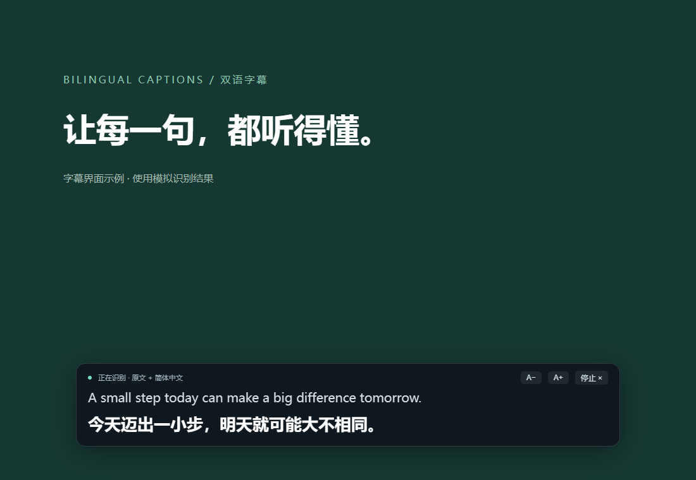

# DeepSeek Bilingual Subtitles

[简体中文](README.zh-CN.md) · English

An open-source Microsoft Edge extension that captions the current browser tab in the original language and Simplified Chinese. Both speech recognition and translation use **your own DeepSeek API key**.

[Download the latest release](https://github.com/acpass/deepseek-edge-subtitles/releases/latest) · [Report an issue](https://github.com/acpass/deepseek-edge-subtitles/issues) · [MIT license](LICENSE)



> **Chunked, near-real-time captions.** DeepSeek's ASR endpoint does not currently stream partial transcripts. This extension uploads short audio segments, displays the original transcript, and then adds the Chinese translation. Actual latency includes segmentation, network transfer, recognition, and translation. The image above uses simulated API responses, not a live transcription benchmark.

## Features

- Capture audio from the tab you explicitly start; no microphone access.
- Recognize the source language automatically and translate into Simplified Chinese.
- Use DeepSeek for both stages, directly from the extension, without a proxy or local server.
- Show a draggable, resizable-text overlay with original text above the translation.
- Keep captions running after the settings popup closes; support webpage fullscreen.
- Choose 3, 4, or 6-second maximum segments; split earlier at pauses and skip quiet audio.
- Keep a bounded processing queue; skip older queued audio if processing falls behind.
- Stop from the overlay or popup; stop on tab reload, navigation, or closure.
- Store the API key for the browser session by default, with optional local persistence.

## Requirements

- Microsoft Edge **124+**; an up-to-date version is recommended.
- A DeepSeek API key with access to the ASR and chat endpoints and sufficient account balance.
- An ordinary HTTP(S) webpage playing audio.

The extension uses Chromium extension APIs. Edge is the tested browser; other Chromium browsers have not been independently validated. The settings interface is currently in Simplified Chinese.

## Install in Edge

1. Download `deepseek-edge-subtitles-v1.0.0.zip` from [Releases](https://github.com/acpass/deepseek-edge-subtitles/releases/latest) and extract it.
2. Open `edge://extensions` in Edge.
3. Enable **Developer mode** and choose **Load unpacked**.
4. Select the extracted `deepseek-edge-subtitles` folder containing `manifest.json`.
5. Find **DeepSeek 双语字幕** in the Extensions menu and optionally pin it to the toolbar.

Keep the extracted folder in place. This is a locally loaded extension, not an Edge Add-ons listing. You can also clone this repository and load its root folder directly; no build step is needed.

To update, extract the new release into a new folder and load that folder, or update the existing extension files and click **Reload** on its extension card. Reopen captions on the video page afterward.

## Use

1. Open the video, livestream, or other audio tab you want to caption.
2. Click the extension icon and enter your **DeepSeek API Key**.
3. Leave the default translation model as `deepseek-flash`, or enter another compatible DeepSeek chat model available to your account.
4. Click **开启当前页字幕** (Start captions for this tab), then play the audio. You may close the popup.
5. Drag the top of the subtitle panel to reposition it. Use **A− / A+** to change its text size.
6. Click **停止 ×** on the panel or **停止字幕** in the popup to stop.

Only one tab is processed at a time. Starting on another tab stops the previous capture. Saving changed settings does not alter an active capture; restart captions to apply them.

| Setting | Default | Meaning |
| --- | --- | --- |
| API Key | Empty | Used for both recognition and translation |
| Remember key on this computer | Off | When off, keep the key in extension session storage; when on, use local extension storage |
| Translation model | `deepseek-flash` | Chat model, with thinking explicitly disabled |
| Maximum segment length | 4 seconds | 3 seconds favors quicker submission; 6 seconds provides more context |
| Default font size | 24 px | Adjustable from 16 to 40 px |

## Privacy and costs

Audio segments are sent to `https://api.deepseek.com/v1/tools/asr`. Recognized text, plus up to two previous transcript segments for context, is sent to `https://api.deepseek.com/v1/chat/completions`. **Both operations are billed to your DeepSeek account.** Consult DeepSeek's current pricing rather than assuming that the extension is free to operate.

The extension does not request the microphone, upload video frames, collect page text, use analytics, or write recordings/transcript history to disk. API keys are not inserted into webpage scripts. A remembered key is local and unsynced, but is **not separately encrypted** by this extension. Stopping aborts local requests; requests already received by DeepSeek may still be billed.

See [PRIVACY.md](PRIVACY.md) for storage, retention, and permission details. This is an independent project and is not an official DeepSeek or Microsoft product.

## Known limitations

- No word-by-word streaming or fixed latency guarantee; captions arrive per processed segment.
- Segment boundaries can split words or sentences. Music, background noise, and overlapping speakers can reduce accuracy.
- If processing falls behind, at most two audio segments wait in the queue; older queued segments may be skipped with a status message.
- Captions are displayed on arrival, not synchronized to the player's timeline. After seeking, stop and restart to discard queued audio.
- Reloading, navigating, or closing the captured tab stops captions. Single-page navigation behavior depends on the site.
- `edge://` pages, new tabs, extension stores, protected media, and some special players may not work.
- Webpage fullscreen is supported; the separate picture-in-picture window is not.
- The target language is Simplified Chinese. Chinese source audio may produce similar text in both lines.
- No subtitle export, speaker labels, offline recognition, or automatic extension updates in this release.

## Troubleshooting

| Symptom | What to check |
| --- | --- |
| No captions | Start captions on a normal webpage, play audible speech, and read the panel/popup status |
| `401` | Check the API key |
| `402` | Check your DeepSeek account balance |
| `403` | Confirm that your account can use the required endpoints |
| `404` | Check the configured model name and API availability |
| Timeouts or skipped segments | Check the network and try 6-second segments |
| Changed settings have no effect | Save, then restart captions |
| Capture stops after errors | Correct the error and restart; fatal API errors or three consecutive failed segments stop capture |

## Development

There are **no extension runtime dependencies** and no bundler. Tests use Node.js 22+; packaging additionally uses Python 3. The optional browser smoke test uses Playwright.

```sh
npm ci
npm run check
npm test
npm run package
```

The package command creates `dist/deepseek-edge-subtitles-v1.0.0.zip` and `dist/SHA256SUMS.txt` using an explicit allowlist. It excludes tests, browser profiles, dependencies, local credentials, and repository metadata.

Optional browser validation:

```sh
npx playwright install chromium
npm run test:browser
```

To use an installed Edge on Windows, set the environment variable `BROWSER_CHANNEL=msedge` before running `npm run test:browser`. Browser testing creates a temporary profile and uses synthetic audio and mocked API responses; it does not call DeepSeek or use your everyday browser profile.

### Architecture

```text
Selected tab audio
  → offscreen document + AudioWorklet
  → mono 48 kHz / 16-bit PCM WAV segments
  → DeepSeek ASR → original transcript
  → DeepSeek Chat (thinking disabled) → Simplified Chinese
  → service worker → isolated subtitle overlay
```

| File | Responsibility |
| --- | --- |
| `background.js` | Capture lifecycle, tab events, message routing, state |
| `offscreen.js` | Audio processing queue, API pipeline, cancellation |
| `pcm-worklet.js`, `audio.js` | Mono mixing, pause splitting, WAV encoding |
| `api.js` | DeepSeek requests, bounded retries, error handling |
| `content.js` | Subtitle overlay, dragging, font size, fullscreen |
| `popup.*` | Settings, API key storage, start/stop controls |

### Validation status

Seven automated tests cover WAV encoding, silence handling, segmentation, request payloads, authentication errors, and request cancellation. Browser smoke checks cover extension loading, settings storage, real AudioWorklet processing of synthetic audio, mocked ASR/translation, overlay visibility, fullscreen, and hiding on stop.

**No real DeepSeek API key was used for the initial release validation.** Actual recognition/translation quality, billing, latency, and the full capture flow on real video sites still require user testing. See [CONTRIBUTING.md](CONTRIBUTING.md) before reporting results; do not include keys or private recordings in issues.

## Documentation and license

- [DeepSeek speech-to-text API](https://api-docs.deepseek.com/guides/asr/)
- [DeepSeek chat completion API](https://api-docs.deepseek.com/api/create-chat-completion/)
- [Microsoft: sideload an Edge extension](https://learn.microsoft.com/en-us/microsoft-edge/extensions/getting-started/extension-sideloading)
- [Changelog](CHANGELOG.md) · [MIT license](LICENSE)
