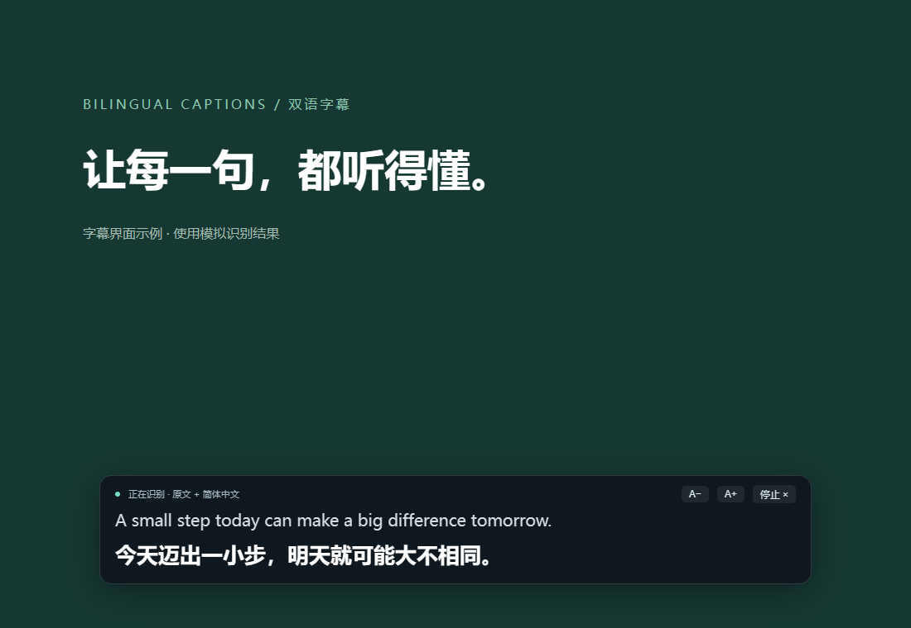

# DeepSeek 双语字幕

简体中文 · [English](README.md)

为当前浏览器标签页生成「原文 + 简体中文」字幕的开源 Edge 扩展。**语音识别和翻译都使用你自己的 DeepSeek API Key**，无需本地服务器或第三方转发。

[下载最新版本](https://github.com/acpass/deepseek-edge-subtitles/releases/latest) · [反馈问题](https://github.com/acpass/deepseek-edge-subtitles/issues) · [MIT 许可证](LICENSE)



> **这是分段近实时字幕。** DeepSeek ASR 当前不支持流式识别。扩展上传短音频片段，先显示原文，再补上中文翻译。实际延迟包含音频分段、网络传输、语音识别和翻译耗时。上图使用模拟 API 响应，不代表真实接口性能。

## 功能

- 只捕获你主动开启字幕的标签页声音，不使用麦克风。
- 自动识别源语言，将识别内容翻译成简体中文。
- 识别与翻译均直接请求 DeepSeek，不经过项目维护者的服务器。
- 原文在上、中文在下，可拖动字幕浮层并调整字号。
- 关闭设置面板后继续运行，支持网页全屏。
- 可选最长 3 / 4 / 6 秒分段；检测到停顿可提前提交，安静音频会跳过。
- 限制待处理队列长度，处理跟不上时跳过较旧片段并提示。
- 在浮层或面板中停止；刷新、跳转、关闭目标标签页时停止。
- 默认仅在浏览器会话内保存 Key，可选择在本机记住。

## 使用要求

- **Edge 124 或以上版本**，建议使用最新版。
- 有效的 DeepSeek API Key、足够的账户余额，以及 ASR 和聊天接口使用权限。
- 播放声音的普通 HTTP(S) 网页。

扩展使用 Chromium 扩展接口，目前验证过的浏览器是 Edge，尚未独立验证其他 Chromium 浏览器。扩展设置界面目前为简体中文。

## 安装到 Edge

1. 从 [Releases](https://github.com/acpass/deepseek-edge-subtitles/releases/latest) 下载 `deepseek-edge-subtitles-v1.0.0.zip` 并解压。
2. 在 Edge 地址栏打开 `edge://extensions`。
3. 开启 **开发人员模式**，点击 **加载解压缩的扩展**。
4. 选择包含 `manifest.json` 的 `deepseek-edge-subtitles` 文件夹。
5. 在扩展菜单中找到 **DeepSeek 双语字幕**，可将它固定到工具栏。

请保留解压后的文件夹。这是本地加载版本，尚未上架 Edge 扩展商店。也可以克隆本仓库后直接加载仓库根目录，无需构建。

更新时，可以解压新版本后重新加载新文件夹，或更新现有扩展文件后在扩展管理页点击 **重新加载**，再回到视频页重新开启字幕。

## 使用方法

1. 打开视频、直播或其他需要字幕的网页。
2. 点击扩展图标，填写 **DeepSeek API Key**。
3. 默认翻译模型为 `deepseek-flash`，也可以填写你账户可用的兼容 DeepSeek 聊天模型。
4. 点击 **开启当前页字幕** 并播放声音，可以关闭设置面板。
5. 拖动字幕顶部状态栏调整位置，点击 **A− / A+** 调整字号。
6. 点击浮层的 **停止 ×** 或面板的 **停止字幕** 结束。

一次仅处理一个标签页，在另一页开启时会停止之前的捕获。修改设置后需要保存并重新开启字幕才会生效。

| 设置 | 默认值 | 说明 |
| --- | --- | --- |
| API Key | 空 | 识别与翻译共用同一个 Key |
| 在这台电脑记住 Key | 关闭 | 关闭时使用会话存储，开启后使用本机扩展存储 |
| 翻译模型 | `deepseek-flash` | 明确关闭思考模式，减少字幕等待 |
| 最长分段 | 4 秒 | 3 秒更快提交，6 秒提供更多上下文 |
| 默认字幕字号 | 24 px | 可在 16～40 px 之间调整 |

## 隐私与费用

音频片段上传至 `https://api.deepseek.com/v1/tools/asr`；识别文字与最多两段先前原文上传至 `https://api.deepseek.com/v1/chat/completions`，先前原文只用于翻译上下文。**两项操作均按你的 DeepSeek 账户计费**，费用以 DeepSeek 当前定价为准。

扩展不调用麦克风，不上传视频画面或网页正文，不包含统计追踪，不将录音或字幕历史写入磁盘。Key 不会注入网页脚本。选择记住 Key 后，本机扩展存储中的 Key 不会同步，但扩展**没有为它额外加密**。停止会取消本地未完成请求，已经到达 DeepSeek 的请求仍可能产生费用。

完整权限、存储和保留说明见 [PRIVACY.md](PRIVACY.md)。本项目为独立项目，非 DeepSeek 或微软官方产品。

## 已知限制

- 不支持逐字流式字幕，不保证固定延迟；每段处理完成后才显示。
- 连续讲话可能在分段处切断词句；音乐、背景噪声和多人同时讲话可能影响准确率。
- 最多保留两段待处理音频；处理速度不足时可能跳过较旧的排队片段，界面会提示。
- 字幕随结果到达显示，不与播放器时间轴精确对齐；快进或拖动进度后建议停止再开启。
- 刷新、导航或关闭目标标签页时停止；单页应用的页面切换行为取决于网站。
- Edge 内部页、新标签页、扩展商店、受保护媒体及部分特殊播放器可能不可用。
- 支持网页全屏，暂不支持独立画中画窗口。
- 目标语言固定为简体中文；中文原声时两行可能相似。
- 当前没有字幕导出、说话人区分、离线识别或自动更新功能。

## 常见问题

| 情况 | 处理方法 |
| --- | --- |
| 没有字幕 | 在普通网页开启字幕，播放有声人声，查看浮层或设置面板的状态 |
| `401` | 检查 API Key |
| `402` | 检查 DeepSeek 余额 |
| `403` | 确认账户拥有相关接口使用权限 |
| `404` | 检查模型名称和接口可用性 |
| 超时或不断跳段 | 检查网络，尝试 6 秒分段 |
| 修改设置不生效 | 保存后重新开启字幕 |
| 出错后停止 | 修正错误后重新开启；鉴权等关键错误或连续三段失败会自动停止 |

## 本地开发

扩展运行时**没有第三方依赖**，无需打包器。自动测试需要 Node.js 22+，生成发布包还需要 Python 3；可选的浏览器测试使用 Playwright。

```sh
npm ci
npm run check
npm test
npm run package
```

打包后生成 `dist/deepseek-edge-subtitles-v1.0.0.zip` 与 `dist/SHA256SUMS.txt`。打包使用明确的文件白名单，不包含测试、浏览器配置、依赖、本地凭据或 Git 元数据。

可选浏览器测试：

```sh
npx playwright install chromium
npm run test:browser
```

Windows 上若要使用已安装的 Edge，可先设置环境变量 `BROWSER_CHANNEL=msedge`。测试使用独立临时浏览器配置、人工音频和模拟 API 响应，不调用 DeepSeek，不使用日常浏览器配置。

### 工作流程

```text
指定标签页音频
  → 后台音频页面 + AudioWorklet
  → 单声道 48kHz / 16-bit PCM WAV 分段
  → DeepSeek ASR → 原文
  → DeepSeek Chat（关闭思考）→ 简体中文
  → 扩展后台 → 字幕浮层
```

| 文件 | 作用 |
| --- | --- |
| `background.js` | 捕获生命周期、标签页事件、消息路由与状态 |
| `offscreen.js` | 音频处理队列、识别翻译流程和取消请求 |
| `pcm-worklet.js`、`audio.js` | 单声道混音、停顿分段、WAV 编码 |
| `api.js` | DeepSeek 请求、有限重试和错误处理 |
| `content.js` | 字幕浮层、拖动、字号、全屏 |
| `popup.*` | 设置、Key 保存和开始/停止控制 |

### 验证状态

7 项自动测试覆盖 WAV 编码、静音与分段、接口请求格式、鉴权错误和请求取消。浏览器测试覆盖扩展加载、Key 存储、真实 AudioWorklet 对人工音频的处理、模拟识别翻译、字幕显示、全屏和停止隐藏。

**首发版本验证没有使用真实 DeepSeek API Key。** 实际识别与翻译质量、费用、延迟，以及真实视频网站上的完整捕获流程仍需用户试用验证。贡献和反馈说明见 [CONTRIBUTING.md](CONTRIBUTING.md)，请勿在 Issue 中提交 Key 或私人录音。

## 参考与许可证

- [DeepSeek 语音识别文档](https://api-docs.deepseek.com/guides/asr/)
- [DeepSeek 聊天接口文档](https://api-docs.deepseek.com/api/create-chat-completion/)
- [微软：本地加载 Edge 扩展](https://learn.microsoft.com/en-us/microsoft-edge/extensions/getting-started/extension-sideloading)
- [更新记录](CHANGELOG.md) · [MIT 许可证](LICENSE)
